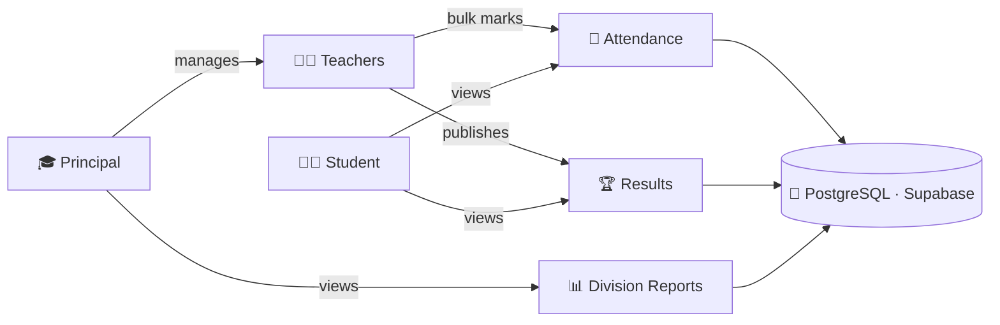
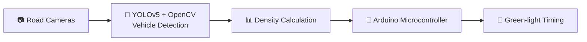

<!-- ===================== HEADER ===================== -->
<div align="center">


<a href="https://git.io/typing-svg">
  
</a>

<br/><br/>

<a href="https://www.linkedin.com/in/amey-shiwal-a334622a9"></a>
<a href="mailto:ameyshiwal833@gmail.com"></a>
<a href="https://github.com/ameyshiwal?tab=repositories"></a>


<br/><br/>

<!-- ===================== NAVIGATION ===================== -->
<b>
<a href="#-about-me">About</a> &nbsp;•&nbsp;
<a href="#-tech-arsenal">Skills</a> &nbsp;•&nbsp;
<a href="#-featured-projects">Projects</a> &nbsp;•&nbsp;
<a href="#-education--certifications">Education</a> &nbsp;•&nbsp;
<a href="#-github-analytics">Stats</a> &nbsp;•&nbsp;
<a href="#-lets-connect">Contact</a>
</b>

</div>

<br/>

---

## 👨‍💻 About Me

<table>
<tr>
<td width="55%" valign="top">

I'm a **Computer Engineering graduate** with a strong foundation in **Java** and **Data Structures & Algorithms**, and a real passion for **backend development**.

I enjoy turning messy requirements into clean, maintainable systems, from **REST APIs** and **relational schemas** to **role-based access control**.

Right now I'm building on that foundation to grow into a **Full Stack Developer**, applying what I learn to real-world projects.

</td>
<td width="45%" valign="top">

```java
public class AmeyShiwal {
  String role  = "SDE";
  String focus = "Backend | Java | Spring";
  String edu   = "B.E. Computer Eng.";
  String cgpa  = "8.23";
  String[] loves = {
    "Clean Code", "OOP", "DSA",
    "REST APIs", "Problem Solving"
  };
  boolean openToWork = true;
}
```

</td>
</tr>
</table>

### ⚡ Quick Facts

| | |
|:--|:--|
| 🎯 **Role** | Software Developer (SDE) |
| 🧠 **Core strength** | Java, OOP, DSA, backend design |
| 🎓 **Education** | B.E. Computer Engineering · 8.23 CGPA |
| 🌱 **Growing into** | Full Stack Development |
| 📜 **Certified in** | Flutter & Dart, Node.js (Udemy) |
| 💼 **Status** | 🟢 Open to SDE / backend roles |

---

## 🛠️ Tech Arsenal

<div align="center">


<br/>

<br/>


</div>

<br/>

<details open>
<summary><b>📂 Skills breakdown (click to collapse)</b></summary>

<br/>

| Category | Technologies |
|:--|:--|
| 💻 **Languages** | `Java` `Python` `Dart` `C++` `SQL` |
| ⚙️ **Backend** | `Spring Boot` `Spring Data JPA` `Hibernate` `Node.js` `Express` |
| 🎨 **Frontend** | `React` `Next.js` `HTML5` `CSS3` `Tailwind CSS` |
| 📱 **Mobile** | `Flutter` `Dart` |
| 🗄️ **Databases** | `PostgreSQL` `MongoDB (NoSQL)` |
| ☁️ **Cloud / BaaS** | `Supabase` `Firebase` |
| 👁️ **AI / CV** | `OpenCV` `YOLOv5` |
| 🧰 **Tools** | `Git` `GitHub` `Arduino` `Jupyter` |

</details>

---

## 🚀 Featured Projects

<div align="center">

| 🏫 School Management | 🛡️ Counterfeit Detection | 🚦 Smart Traffic Lights |
|:--:|:--:|:--:|
| Spring Boot · PostgreSQL | React · Next.js | Python · OpenCV · YOLOv5 |
| *Personal · Feb 2026* | *Final Year · Apr 2025* | *Diploma Group · Mar 2022* |

</div>

<br/>

<details open>
<summary><b>🏫 School Management System</b> &nbsp;·&nbsp; <i>Full-stack, role-based platform</i></summary>

<br/>

A role-based platform where **Principal**, **Teacher** and **Student** each get separate access controls and dashboards.

**✨ Highlights**
- 🔌 **15+ REST API endpoints** for teachers, students, attendance, results and division performance reports
- 🗄️ **Relational schema** in PostgreSQL (hosted on Supabase) using **Spring Data JPA & Hibernate**
- ⚡ **Bulk attendance marking**: a teacher submits attendance for a whole division in **one API call**

**🧭 How roles interact**



**🧰 Stack:** `Java` `Spring Boot` `Spring Data JPA` `Hibernate` `PostgreSQL` `Supabase` `REST`

🔗 [Browse my repositories](https://github.com/ameyshiwal?tab=repositories)

</details>

<details open>
<summary><b>🛡️ Counterfeit Detection System</b> &nbsp;·&nbsp; <i>Web app against product counterfeiting</i></summary>

<br/>

A comprehensive web application designed to combat product counterfeiting and protect brand integrity.

**✨ Highlights**
- 🔐 Securely **register products** and generate **unique authentication codes**
- 📡 **Real-time tracking & monitoring dashboards** to spot potential counterfeits
- 🎞️ Responsive **React / Next.js** frontend with animated UI and interactive documentation
- 📈 Builds consumer trust and cuts losses from counterfeit distribution

**🧰 Stack:** `React` `Next.js` `TypeScript` `Full-Stack`

🔗 [View on GitHub](https://github.com/ameyshiwal/CounterFeit-Detection-System)

</details>

<details open>
<summary><b>🚦 Density Based Traffic Light Control System</b> &nbsp;·&nbsp; <i>AI + hardware</i></summary>

<br/>

A dynamic traffic signal system that adjusts green-light timing to the real-time traffic density at a junction.

**🔄 How it works**



**✨ Highlights**
- 👁️ **OpenCV** for real-time computer vision
- 🎯 **Custom-trained YOLOv5** model for vehicle detection
- ⏱️ Arduino assigns the green-light duration for each side of the junction

**🧰 Stack:** `Python` `OpenCV` `YOLOv5` `Arduino` `Jupyter`

🔗 [View on GitHub](https://github.com/ameyshiwal/Density_Based_Traffic_Light_Control_System)

</details>

<details>
<summary><b>📱 More work (Flutter & Web)</b></summary>

<br/>

| Project | What it is |
|:--|:--|
| 🛒 [**shop_app**](https://github.com/ameyshiwal/shop_app) | A Flutter shopping app |
| 📚 [**Flutter Projects**](https://github.com/ameyshiwal/FLutter_Projects) | Apps built while learning Flutter & Dart |
| 🌐 [**myportfolio**](https://github.com/ameyshiwal/myportfolio) | My personal portfolio website |

</details>

---

## 🎓 Education & Certifications

```text
 2019 ─────────────── 2022 ─────────────────────── 2025 ──────▶ Now
   │                    │                            │
   ▼                    ▼                            ▼
 Diploma starts   Diploma done (87.31%)       B.E. done (8.23 CGPA)
                   B.E. starts (Sept 2022)     Working towards SDE role
```

| 🏫 Institution | 📘 Program | 📅 Period | 🏅 Score |
|:--|:--|:--|:--:|
| **Trinity College of Engineering and Research**, Pune | B.E. in Computer Engineering | Sept 2022 – Jun 2025 | **8.23 CGPA** |
| **A.I.S.S.M.S**, Pune | Diploma in Computer Engineering | Jun 2019 – Jun 2022 | **87.31 %** |

<p>
  
  
</p>

---

## 📊 GitHub Analytics

<div align="center">


<br/>


<br/>


<br/>


</div>

### 🏆 Achievements

<a href="https://github.com/ameyshiwal?achievement=pull-shark&tab=achievements">
  
</a>

---

## 🎯 Roadmap

| Status | Goal |
|:--:|:--|
| 🟢 **Now** | Building solid, scalable **backend systems** with Java & Spring Boot |
| 🟡 **Next** | Pairing strong backends with modern **React / Next.js** frontends (Full Stack) |
| 🔵 **Always** | Sharpening **DSA & problem-solving** skills |
| 🚀 **Goal** | Landing an **SDE** role where I can contribute, learn fast and grow |

---

## 🤝 Let's Connect

<div align="center">

I'm open to **SDE / backend roles**, collaborations and good conversations about tech.

<a href="https://www.linkedin.com/in/amey-shiwal-a334622a9"></a>
<a href="mailto:ameyshiwal833@gmail.com"></a>

<br/><br/>


</div>
